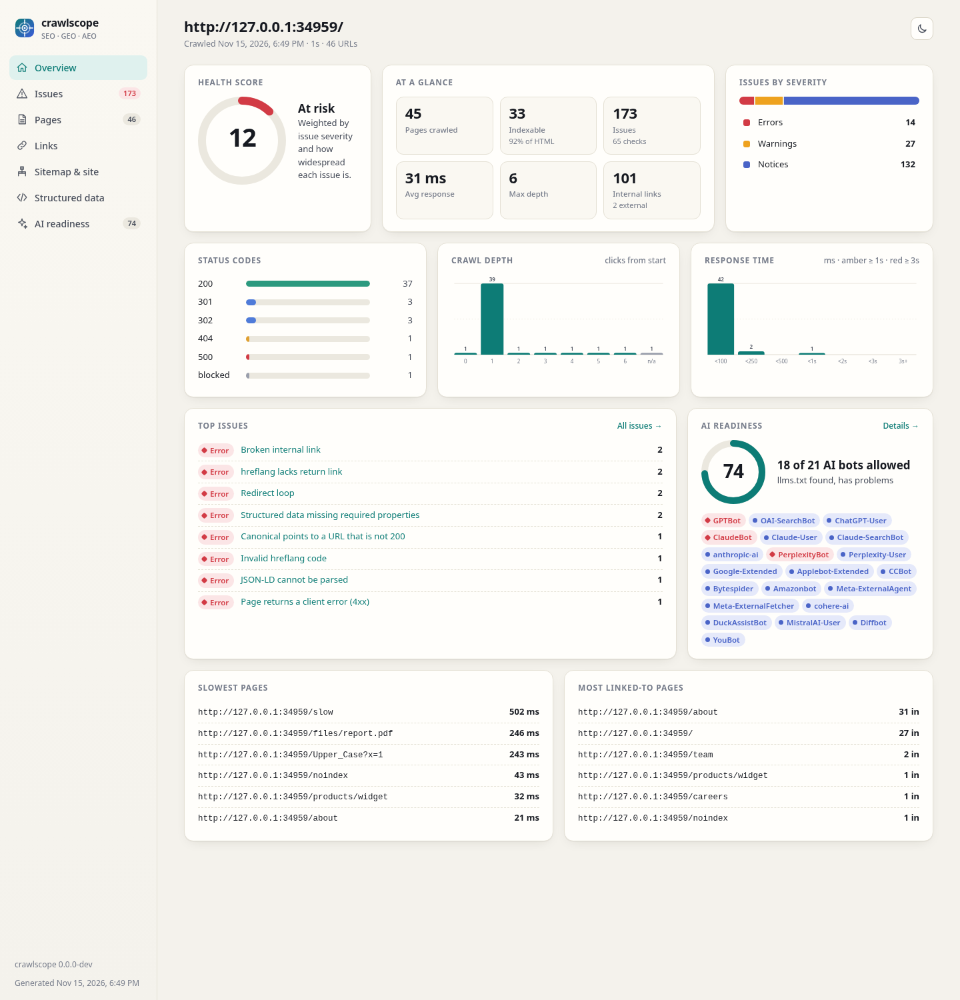
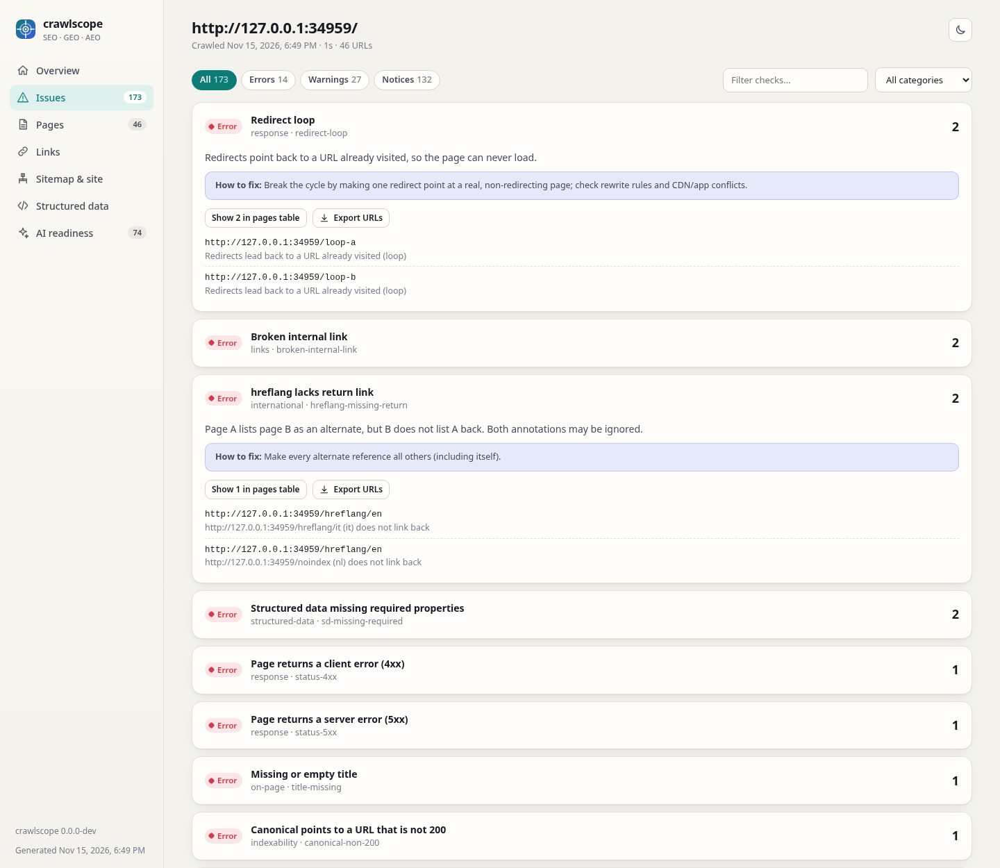
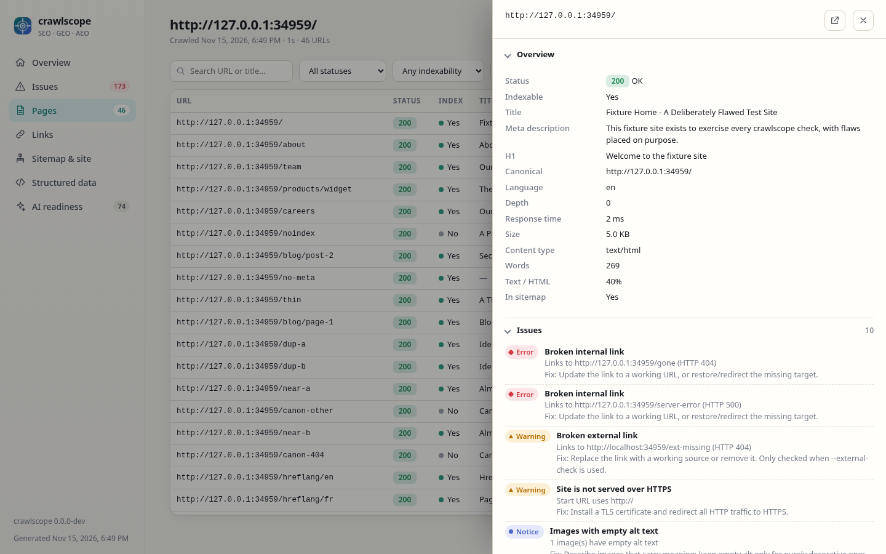
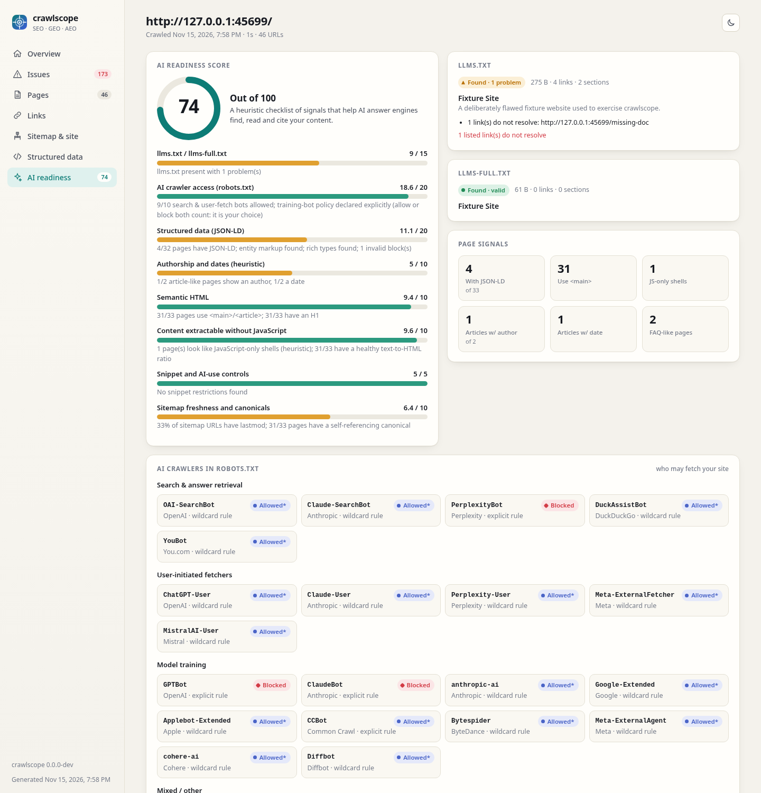
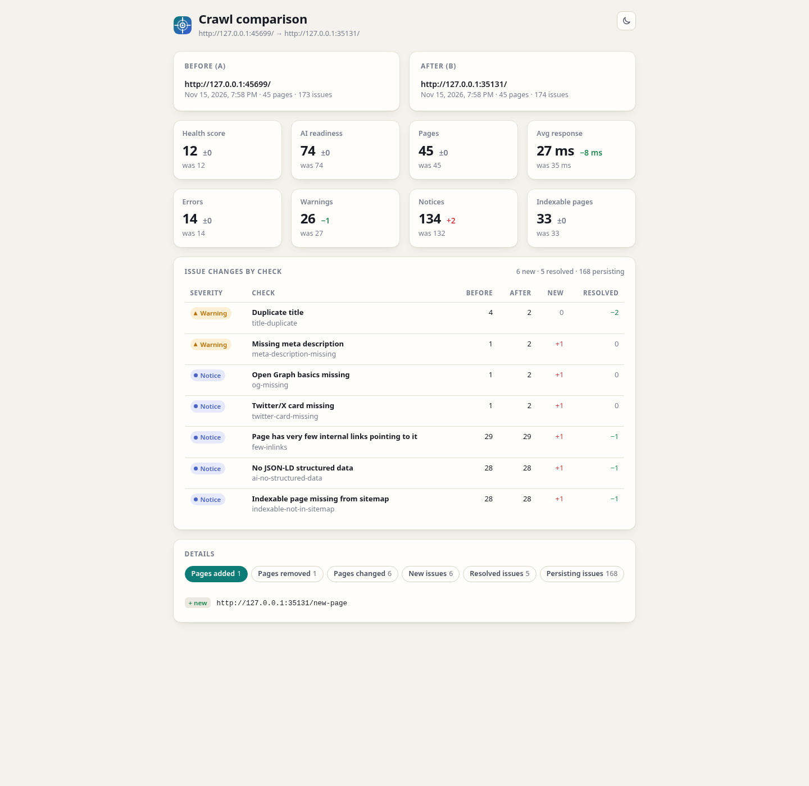
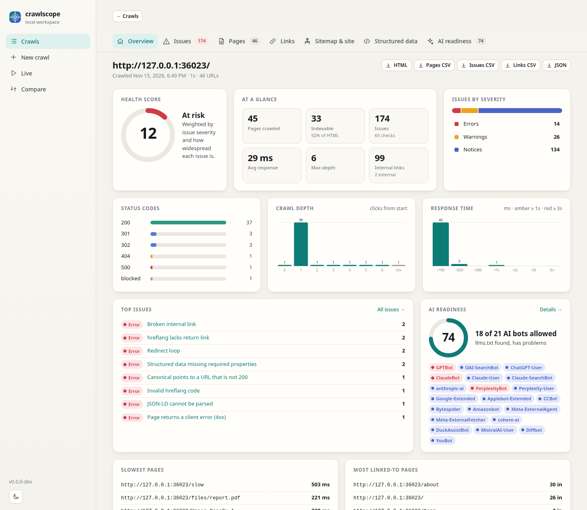
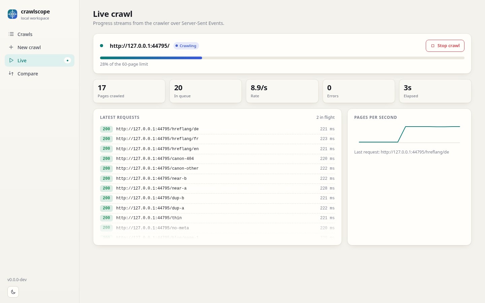

<div align="center">

# crawlscope

**A free, local, open-source SEO crawler with GEO/AEO checks, crawl diffing and an agent-native interface.**

[](https://github.com/xw2781/crawlscope/actions/workflows/ci.yml)
[](LICENSE)



</div>

No URL limit, no account, no telemetry. crawlscope runs on your machine, writes plain files (JSON, CSV, one self-contained HTML
report) and also speaks MCP so coding agents can crawl, read and diff sites directly.

## 30-second quickstart

```bash
npx crawlscope crawl https://example.com --max-pages 200     # needs Node 20+; the package is not on npm yet, see "Install"
open crawlscope-data/*/report.html                           # or: crawlscope ui
```

You get a console summary, `report.html`, `crawl.json`, `pages.csv`, `issues.csv` and `links.csv` in `./crawlscope-data/<host>-<timestamp>/`.

## Install

The package has not been published to npm yet. Until then, from a clone:

```bash
git clone https://github.com/xw2781/crawlscope && cd crawlscope
npm ci && npm run build
npm pack && npm i -g ./crawlscope-*.tgz      # gives you the `crawlscope` command
```

Once published, `npx crawlscope ...` and `npm i -g crawlscope` will work as shown in the examples.

## Why crawlscope

* **Free and unlimited.** MIT licensed. No page cap, no licence key, no cloud. Crawl as many URLs as your machine and the target can take.
* **Local and open.** Everything stays on disk in documented formats ([schema](docs/schema.md)). Read the code, change a check, send a PR.
* **Agent-native.** `--json` mode with clean stdout and meaningful exit codes, plus an [MCP server](docs/mcp.md) with token-friendly tools and a ready-made [Claude Code skill](skills/crawlscope/SKILL.md).
* **GEO / AEO checks built in.** `llms.txt` validation, per-bot robots.txt status for 21 AI crawlers (training vs search vs user-fetch), structured-data coverage, authorship and dates, JS-only shell detection, snippet controls.
* **Crawl diff.** Compare two crawls (before/after a deploy, staging vs production): pages added/removed/changed, issues new/resolved/persisting.
* **A report you can send.** One self-contained HTML file: works offline, light/dark, searchable and sortable pages table, per-issue fix guidance.
* **Zero install to try.** `npx` and go.
* **Polite by default.** robots.txt (RFC 9309), per-host delay, backoff on 429/503, size caps, a crawl-trap guard. See [Responsible crawling](#responsible-crawling).

## Features

* Crawler: same-site BFS with include/exclude regexes, depth and page limits, subdomains, sitemap discovery (robots, `sitemap.xml`, sitemap index, gzip), resume and incremental re-crawl using ETag / Last-Modified, graceful Ctrl+C with partial results.
* **102 checks** with ids, severities and how-to-fix text: responses and redirect chains/loops, broken internal and external links, titles, descriptions, headings, images, canonicals (HTML and HTTP `Link` header), hreflang, duplicate and near-duplicate content, thin content, URL hygiene, noindex / `X-Robots-Tag`, meta refresh, trailing-slash and `index.html` duplicates, sitemap problems, orphans, depth, HTTPS/HSTS, mixed content, third-party scripts (SRI, CSP, `http://` scripts), soft-404 probe, Open Graph/Twitter, and structured data validation (JSON-LD, microdata, RDFa).
* Robust parsing: non-UTF-8 charsets (header, BOM, `<meta charset>`), `<base href>`, binary or oversized bodies, very long URLs, iframe and `srcset` URLs recorded but never crawled.
* Outputs: `crawl.json` (versioned schema), three CSV files, `report.html`.
* Local web UI (`crawlscope ui`, 127.0.0.1 only) with live progress, history and side-by-side comparison.
* MCP server over stdio.

### Report and UI

| Issues with fix guidance | Page detail drawer |
|---|---|
|  |  |

| AI-readiness | Crawl diff |
|---|---|
|  |  |

| Local UI: dashboard | Local UI: live crawl |
|---|---|
|  |  |

## How it compares

Screaming Frog SEO Spider is the established desktop crawler and is far more mature and feature-rich than crawlscope today.
Facts below come from the vendor's website as checked on 2026-11-15; check it for current terms.

| | crawlscope | Screaming Frog SEO Spider (free) | Screaming Frog SEO Spider (paid) |
|---|---|---|---|
| Price | Free, MIT | Free | $279 / user / year (£199) |
| URLs per crawl | Unlimited (you choose `--max-pages`) | 500 | No 500-URL cap (see vendor for limits) |
| Source | Open source | Closed | Closed |
| Install | `npx` / Node 20+ | Desktop app | Desktop app |
| Save and compare crawls | Yes | Not in free version | Yes |
| JavaScript rendering | **No** (not yet) | Not in free version | Yes |
| Custom extraction | **No** (not yet) | Not in free version | Yes |
| GA / GSC / PageSpeed integrations | **No** (not yet) | Not in free version | Yes |
| Scheduling, command-line automation | CLI + your own scheduler / CI | not verified | Yes (vendor lists scheduling and command-line automation) |
| Accessibility audit, spelling/grammar, visualisations | **No** (not yet) | not verified | Yes (vendor lists accessibility auditing) |
| MCP server | Yes | not verified | Yes (listed by the vendor) |
| GEO/AEO checks (llms.txt, AI-bot access, AI-readiness score) | Yes | not verified | not verified |

Our angle is narrow: **free, unlimited, open source, zero-install, with GEO/AEO checks and agent-friendly output.** If you need JavaScript
rendering, Search Console data or custom extraction today, use a tool that has them. Other open-source crawlers exist; we make no
comparison claims about them.

## Not yet / roadmap

crawlscope does **not** do these yet:

* No JavaScript rendering: pages are analysed from the raw HTML response. Client-side-rendered sites look thin (and are flagged as JS shells).
* No Google Analytics, Search Console or PageSpeed Insights integrations.
* No custom extraction (CSS/XPath/regex) or custom search.
* No spelling or grammar checks.
* No accessibility audit (only basics such as image alt text and `lang`).
* No site visualisations (link graphs, tree maps).
* No authentication / cookies / form login, no `--user-agent` presets for rendering bots, no scheduler of its own.
* No JavaScript-aware link discovery, no PDF/image analysis beyond status and size.

Ideas are welcome as issues.

## CLI reference

```text
crawlscope crawl <url> [options]
  -o, --out <dir>                 output directory (default ./crawlscope-data/<host>-<timestamp>)
  --max-pages <n>                 stop after N pages (default unlimited)
  --max-depth <n>                 maximum link depth from the start URL
  --concurrency <n>               parallel requests (default 4)
  --delay <ms>                    minimum delay between requests to a host (default 250)
  --include <regex> / --exclude <regex>   repeatable URL filters
  --subdomains                    also crawl subdomains of the start host
  --external-check                HEAD-check outbound links (never crawls them)
  --sitemap <url>                 extra sitemap (repeatable)
  --respect-nofollow              do not follow nofollow links
  --max-urls-per-pattern <n>      crawl-trap guard, default 1000 (0 = unlimited)
  --timeout <ms>                  per-request timeout (default 15000)
  --user-agent <string>           User-Agent (robots.txt group matching uses its product token)
  --no-robots --i-own-this-site   ignore robots.txt (only on sites you are authorised to crawl)
  --slow-ms <ms> --very-slow-ms <ms>   response-time thresholds
  --ai-bots-check                 also verify links listed in llms.txt
  --resume                        continue an interrupted crawl / re-crawl incrementally
  --format html,json,csv          outputs to write
  --json                          machine-readable summary on stdout (logs on stderr)
  --fail-on error|warning         exit 1 if issues of that severity or worse exist

crawlscope llms <url> [--json] [--max-pages 10] [-o dir]    quick GEO/AEO check (alias: ai-readiness)
crawlscope report <crawl-dir> [--open]                      regenerate report.html and CSVs
crawlscope diff <crawlA> <crawlB> [--json] [--html out.html]
crawlscope ui [dir] [--port 4173] [--no-open]               local web UI on 127.0.0.1
crawlscope mcp [--data-dir dir]                             MCP server on stdio
```

Exit codes: `0` ok, `1` `--fail-on` threshold reached, `2` invalid usage, `130` interrupted.

## MCP setup (for AI agents)

```bash
claude mcp add crawlscope -- npx -y crawlscope mcp      # Claude Code (once published; see docs/mcp.md for local installs)
```

Tools: `crawl_site`, `get_crawl_summary`, `list_crawls`, `list_issues`, `get_page`, `find_pages`, `audit_url`, `check_ai_readiness`,
`check_robots_url`, `diff_crawls`, `export_report`. Crawls are stored in `~/.crawlscope` (`CRAWLSCOPE_DATA_DIR` to change).
Config for Cursor, Codex and generic clients: [docs/mcp.md](docs/mcp.md). Agent workflow and the Claude Code skill: [docs/agents.md](docs/agents.md).

## Third-party script inventory

Every `<script src>` is recorded per page (absolute URL, third-party or not, `integrity`/SRI, `crossorigin`), along with whether the page has a `Content-Security-Policy` (header or `<meta>`) or only a report-only one. Hosts outside the site's registrable domain are third-party; subdomains of the start host are first-party.

The site-level inventory lists each external host with the number of pages loading it, example URLs, SRI coverage and a category (experimentation, tag manager, analytics, advertising, CDN, …) from a small built-in list. There are no network lookups. It appears in the console summary, `crawl.json` (`summary.thirdPartyScripts`), the HTML report (Sitemap & site) and the MCP `get_crawl_summary` tool.

| Check | Severity | What it looks for |
|---|---|---|
| `third-party-script-no-sri` | notice | external script without `integrity`, one finding per host. For dynamic snippets (Optimizely, Google Tag Manager, …) SRI is not possible, and the message says so |
| `insecure-script` | error | `<script src="http://…">` on an HTTPS page |
| `csp-missing` | notice | HTML pages with no Content-Security-Policy (reported once per site) |
| `csp-report-only` | notice | only `Content-Security-Policy-Report-Only`, nothing enforced (once per site) |

This is a visibility aid, not a malware scanner: it shows what your pages load, not whether it is malicious. Prompted by the November 2026 compromise of Optimizely Web snippets on `cdn.optimizely.com` ([Report URI write-up](https://blog.report-uri.com/worlds-largest-brands-infected-with-malware-via-optimizely/)).

## GEO / AEO checks

| Check | What it looks for |
|---|---|
| `llms-txt-missing`, `llms-txt-invalid`, `llms-full-missing` | `/llms.txt` and `/llms-full.txt` present and following the llmstxt.org format (title, summary, link sections) |
| `ai-search-bot-blocked` | robots.txt rules per AI crawler (21 bots, classified as training / search / user-fetch), including partial blocks |
| `ai-no-structured-data`, `ai-no-sameas` | JSON-LD coverage; Organization `sameAs` entity links |
| `ai-missing-author`, `ai-missing-date` | authorship and publish/modified dates on article-like pages |
| `ai-no-semantic-main` | `<main>` / `<article>` landmarks |
| `ai-js-shell` | pages whose content only appears after JavaScript runs |
| `ai-snippet-restricted` | `nosnippet`, `max-snippet`, `noai` style directives |
| `ai-low-text-ratio`, `ai-sitemap-lastmod-missing` | text-to-markup ratio; sitemap `lastmod` coverage |

The 0-100 **AI-readiness score** mixes hard checks (files, rules, markup in the raw HTML) with heuristics, and the output says so.
No one can promise that a score changes how AI products cite a site.

## CI usage

```yaml
# .github/workflows/seo.yml
name: SEO crawl
on: { pull_request: {}, schedule: [{ cron: '0 6 * * 1' }] }
jobs:
  crawl:
    runs-on: ubuntu-latest
    steps:
      - uses: actions/setup-node@v4
        with: { node-version: 22 }
      - run: npx -y crawlscope crawl https://staging.example.com --max-pages 500 --fail-on error -o seo-crawl
      - if: always()
        uses: actions/upload-artifact@v4
        with: { name: seo-report, path: seo-crawl }
```

`--fail-on error` (or `warning`) turns the crawl into a gate. Compare against a stored baseline with `crawlscope diff baseline new --json`.
(Replace `npx -y crawlscope` with your local install while the package is unpublished.)

## Configuration

crawlscope has no config file: everything is a flag (above) or an MCP tool argument. Environment: `CRAWLSCOPE_DATA_DIR` (MCP crawl storage).
Check thresholds (`--slow-ms`, `--very-slow-ms`) are flags; other thresholds (title length etc.) are in `src/options.ts` (`DEFAULT_THRESHOLDS`)
and can be overridden through the library API (`resolveOptions`).

## Output files

| File | Contents |
|---|---|
| `crawl.json` | everything: options, pages, links, issues, check metadata, robots, sitemaps, AI-readiness, site probes. Schema: [docs/schema.md](docs/schema.md) (types in `src/types.ts`) |
| `pages.csv`, `issues.csv`, `links.csv` | spreadsheet-friendly exports (formula-injection safe) |
| `report.html` | self-contained report |
| `state.jsonl` | incremental state for `--resume` |

## Responsible crawling

crawlscope obeys robots.txt (RFC 9309: longest-match Allow/Disallow, `*` and `$`, user-agent groups, `Crawl-delay` as a per-host minimum),
keeps a per-host delay and concurrency cap, backs off on 429/503 (honouring `Retry-After`), caps body sizes, stops following endless URL
patterns (calendars, filters) and never crawls external sites. An unreachable or 5xx robots.txt is treated as "disallow all", as the RFC
requires. `--no-robots` requires `--i-own-this-site`. Its default User-Agent identifies the tool and links to this repository. Only crawl sites
you own or have permission to crawl; the agent/MCP defaults are deliberately small (200 pages).

## Development

```bash
npm ci && npm run build && npm test && npm run lint
npx tsx scripts/screenshots.mjs        # regenerate docs/img (needs Chrome; set CHROME=/path)
bash scripts/smoke-public.sh           # very light real-world check: example.com / example.org only, 5 pages each
```

Tests run against a deliberately flawed local fixture site (`test/fixtures/site`) and never touch public sites. See [CONTRIBUTING.md](CONTRIBUTING.md).
The original build brief is kept in [docs/BUILD-SPEC.md](docs/BUILD-SPEC.md).

## Clean-room statement

crawlscope is independently implemented from public SEO documentation (RFC 9309, sitemaps.org, schema.org, Google Search Central,
llmstxt.org) and black-box knowledge. It is not affiliated with or endorsed by Screaming Frog; no code, UI, text or assets were copied.

## License

[MIT](LICENSE)
